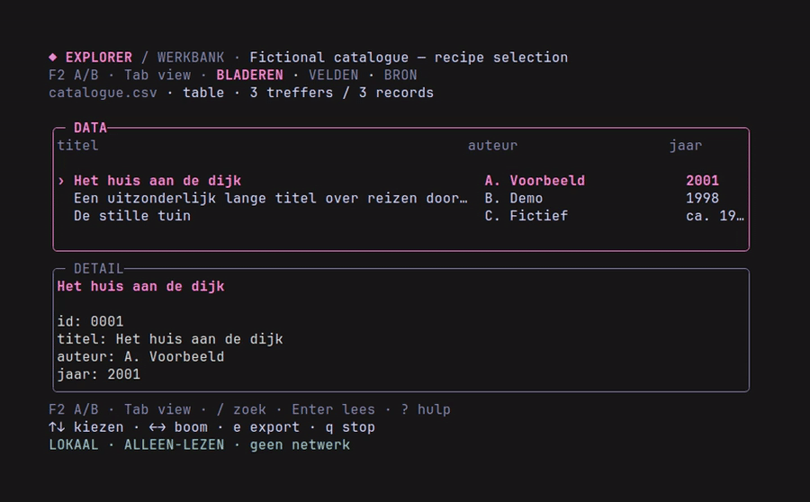

# Dataset Explorer TUI Kit

Small, focused terminal explorers for datasets — built on the Charm ecosystem.

The reusable kit provides a starting point; each explorer lives in its own
repository and can evolve independently. No LLM is required at runtime.

## The whole kit

The kit brings together agent guidance, explicit recipes, project tooling, local
data readers, and a reusable terminal UI. Build-time assistance stays separate
from the app you run. Choose the smallest useful solution: a recipe first,
custom code only for real capability gaps.

<picture>
  <source media="(prefers-color-scheme: dark)" srcset="https://raw.githubusercontent.com/Dataset-explorer-tui-kit/.github/main/profile/assets/kit-overview-dark.svg">
  
</picture>

**Use what fits your data:** tables, feeds, or archival hierarchies. Keep the
source unchanged, preserve its structure, and export only the actual matches.
A database is not mandatory; large-data adapters are deliberate project choices,
not implied features of every recipe.

## From a dataset to your own explorer

Give a coding agent a local dataset, a research question, and the kit's
[workflow skill](https://github.com/Dataset-explorer-tui-kit/dataset-explorer-kit/blob/main/skills/dataset-explorer/SKILL.md).
The agent uses the kit rather than starting an interface from scratch.

<picture>
  <source media="(prefers-color-scheme: dark)" srcset="https://raw.githubusercontent.com/Dataset-explorer-tui-kit/.github/main/profile/assets/kit-workflow-dark.svg">
  
</picture>

**The agent helps build it. It does not run inside it.** The resulting explorer
needs no LLM or Hermes at runtime. Original datasets stay unchanged; selected-cover
fetching is an optional feature, not a dataset download pipeline.

### Ask your agent

> Use the Dataset Explorer Kit to inspect my local dataset at `[path]` and build
> an explorer for `[research question]`. Read the bundled skill first, preserve
> the original data, prefer a recipe, and scaffold a standalone app only when
> needed. Verify the result with tests and a real terminal run.

CSV/TSV tables, JSONL records and EAD archival hierarchies have existing readers.
Other formats or custom behavior may need a focused adapter. A recipe is often
enough: a new dataset does not automatically need a new repository.

Both diagrams are rendered with Pele, with light and dark variants selected by your browser's color preference. [Editable sources and rendering instructions](assets/DIAGRAMS.md).

## A project history that explains why

For an authorized standalone project, the agent creates the folder, Git repo,
active `AGENTS.md`, initial dataset profile, and decision/checkpoint helpers.
You describe what you want; **the agent takes the decision notes from the session**.
Reasons distinguish explicit user intent, agent inference, and unknowns.

Every meaningful increment gets required tests/vet/build and an explicit-file
local commit containing its decision and verification receipt. Failed checks stop
the checkpoint; no background watcher or automatic push is installed. Decision
notes can later be compared across projects; no DSPy optimizer is installed yet.

**CI and Dependabot are included automatically in every new scaffold.** CI checks
formatting, module consistency, vet, tests, race detection and build using only
fixtures. Dependabot proposes Go and GitHub Actions updates for review, without
auto-merging. Publishing is not complete until actual GitHub CI has been checked.

Before publishing a new explorer here, record the actual binary with **VHS** on
reviewed safe data, embed the GIF in its README, retain organization attribution,
and update the repository guide below. Visibility stays private unless public
publication is explicitly approved.

The demo contains only fictional records, not project datasets or session history.
See the kit's [project workflow](https://github.com/Dataset-explorer-tui-kit/dataset-explorer-kit/blob/main/docs/PROJECT-WORKFLOW.md)
and [recipe-selection guide](https://github.com/Dataset-explorer-tui-kit/dataset-explorer-kit/blob/main/docs/RECIPE-SELECTION.md).
The workflow above includes checkpoints and separately authorized publication;
the project guide explains their safety boundaries in detail.

## Repositories

| Repository | Purpose |
| --- | --- |
| **[dataset-explorer-kit](https://github.com/Dataset-explorer-tui-kit/dataset-explorer-kit)** | Main repository: reusable kit, recipe selection, agent-managed decision history, scaffolding and VHS demos. |
| [cbk-explorer](https://github.com/Dataset-explorer-tui-kit/cbk-explorer) | A dataset-specific explorer for the Dutch children's book catalogue. |
| [tg-osint](https://github.com/Dataset-explorer-tui-kit/tg-osint) | A standalone Telegram OSINT reader. |
| [dutch-news-explorer](https://github.com/Dataset-explorer-tui-kit/dutch-news-explorer) | A read-only explorer for 255,524 Dutch news articles (2010–2023): the default path is a derived, read-only DuckDB snapshot with lazy paging and full-text search; browse by date, title and category, inspect the exact source line and export the matches. |

Start with the **[main README](https://github.com/Dataset-explorer-tui-kit/dataset-explorer-kit#readme)**
for an overview of the kit and its applications.

These repositories are currently private; their links require access.

A database stays optional in the kit. `dutch-news-explorer` shows the deliberate
exception: when its in-memory CSV path measured about 1.8 GB, it derived a
read-only DuckDB snapshot outside Git, keeps the unchanged CSV for exact source
lines, and pages records with bounded memory. The in-memory CSV fallback remains
available explicitly.
